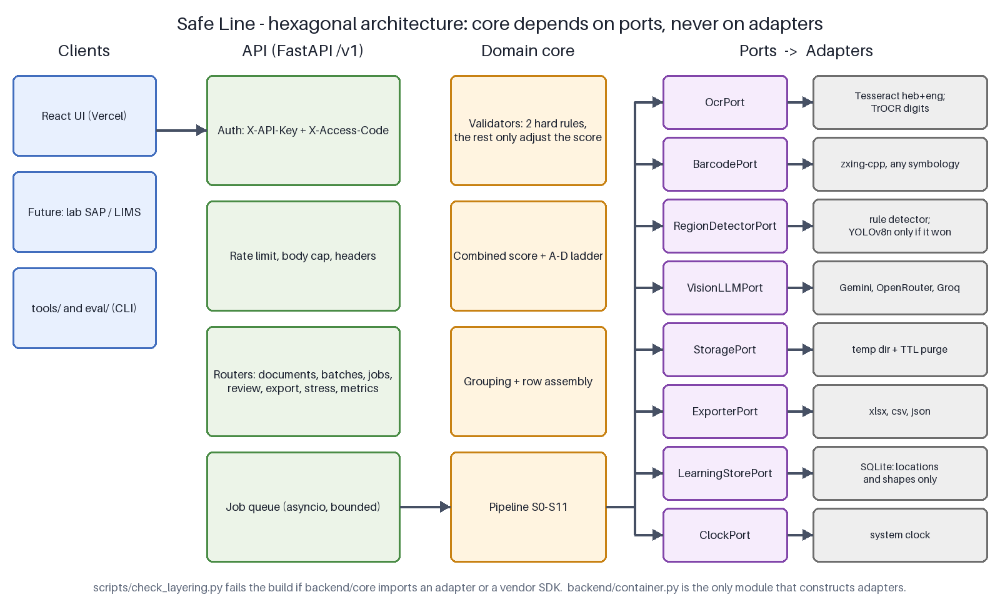

# Safe Line · שורה בטוחה

Turns Israeli medical commitment forms — scanned, photographed, rotated, handwritten — into
validated spreadsheet rows. Wherever the engine is not certain it says so, explains why, and shows
the exact pixels it read.

> Open Source AI Hackathon 2026 · Central Virology Laboratory challenge, Israeli Ministry of Health
> Team: Ahuba, Shira

**Live demo:** _(link added in Task 28; access code in the submission description)_

<!-- Task 29 adds the recorded demo GIF here:

-->


## Results

_Measured on the 15 held-out pages, which were never used for calibration, rule writing or reader
selection. Filled in Task 30 — a target is never published as an achievement._

| Metric | Result | Target |
|---|---|---|
| Silent error (wrong **and** not flagged) | — | ≤ 1% |
| Flag recall | — | ≥ 95% |
| Printed-field accuracy | — | ≥ 98% |
| Handwritten-field accuracy | — | ≥ 90% |
| Closed locally, no cloud call | — | measured |
| 30 forms end to end | — | < 4 min |
| Development cost | $0 | $0 |

See `eval/results/final_report.md` and [`docs/limitations.md`](docs/limitations.md).

## Run locally

```bash
cp .env.example .env            # fill in APP_ACCESS_CODE, API_KEY, GEMINI_API_KEYS
docker compose up --build       # backend :8000, frontend :5173
```

Without Docker:
```bash
pip install -r requirements.txt && uvicorn backend.app:app --port 8000
cd frontend && npm ci && npm run dev
```

Hebrew Tesseract is required: `tesseract --list-langs` must include `heb`. The Docker image
installs it; on Windows use the UB-Mannheim build with the Hebrew pack and set `TESSERACT_CMD`.

Set `LOCAL_ONLY=true` to run with no external service at all — more fields are flagged for review
and nothing leaves the machine.

## How it works

Code first, model second, human only where needed. Each field climbs the cascade only until it is
resolved:

```
barcode · check digit · closed list   →  local OCR (heb+eng)  →  local handwritten digits
   →  cloud vision, crops only  →  orange flag with a reason
```

The decision to escalate comes from a **combined score** built from seven independent signals, not
from the OCR engine's own confidence — on handwriting Tesseract reports high confidence for values
it invented, which is exactly how a wrong number reaches a spreadsheet unnoticed.

<!-- Task 29 adds the exported diagram here:

-->

Full design: [`docs/ARCHITECTURE.md`](docs/ARCHITECTURE.md) ·
Complete plan: [`docs/PLAN.md`](docs/PLAN.md)

## Tools and models

**Local engine:** Tesseract 5 (Hebrew + English) · zxing-cpp (barcodes, any symbology) ·
OpenCV headless (orientation, deskew, CLAHE) · pypdfium2 · TrOCR-small ONNX int8 (handwritten
digits) · YOLOv8n ONNX (region detection, included only if it won the bake-off) · rapidfuzz ·
Pydantic v2.

**Cloud, free tiers, crops only:** Gemini 2.5 Flash / Flash-Lite · fallback OpenRouter free vision
models · last resort Groq.

**Application:** FastAPI · React + Vite + TypeScript + Tailwind + Radix · openpyxl · SQLite.

**Infrastructure, all free:** Vercel · Render (Docker) · UptimeRobot · Hugging Face Space
(standby) · GitHub Actions.

**Offline training only, not shipped at runtime:** ultralytics (AGPL-3.0), transformers, optimum.

## Privacy

Medical forms contain the most sensitive category of personal information, so the engine is built
to send as little as possible:

- Only **crops** of unresolved fields leave the machine, never a full page.
- Clinical regions — diagnosis, requested test, physician notes — are **never** sent.
- All page images and extracted values are purged after 30 minutes.
- No personal data in logs or in the learning store, which keeps only field *locations* and
  abstracted value *shapes*.
- `LOCAL_ONLY=true` makes the engine fully offline.

Details: [`docs/privacy.md`](docs/privacy.md). Medical information is "sensitive information"
under the Israeli Privacy Protection Law; a real deployment requires Ministry of Health
information-security approval. This repository is not legal advice.

## Repository

| Path | Contents |
|---|---|
| `docs/PLAN.md` | The complete specification: domain, architecture, pipeline, 30 tasks |
| `docs/ARCHITECTURE.md` | Ports and adapters, data flow, decision records |
| `docs/limitations.md` | What does not work yet, and licence notices |
| `.kiro/steering/` | Always-on project rules and code conventions |
| `.kiro/skills/` | Procedures: run the evaluation, add an institution, train the detector |
| `backend/` | FastAPI service and the pure-Python engine |
| `frontend/` | React RTL review workspace |
| `config/` | Closed sender list, model selection, versioned prompts |
| `eval/` | Gold set tooling, augmentation, metrics, bake-off |
| `reference/` | The four challenge PDFs — **git-ignored** |

## Licence

[MIT](LICENSE) for our code. Third-party notices in [`docs/limitations.md`](docs/limitations.md).
