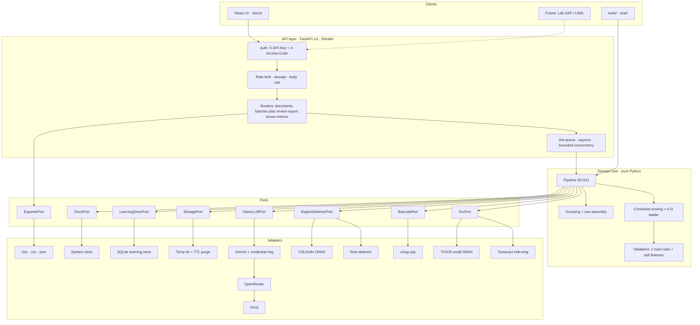
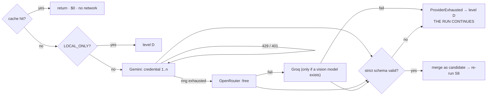
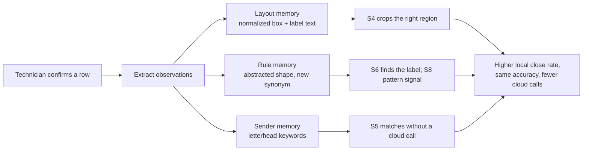

# Safe Line — Architecture

Companion to [`PLAN.md`](./PLAN.md). This document is the architectural reference: style, layers,
ports, data flow, and the decision records behind each choice.

## 1. Style: Hexagonal (Ports and Adapters)

The domain core — pipeline, scoring, validators — is pure Python. It imports no framework and no
vendor SDK. Everything external is reached through a `typing.Protocol` **port**, implemented by an
**adapter**.

**Dependency rule, enforced by `scripts/check_layering.py` in CI:**

```
adapters  →  ports  →  core        allowed
core      →  adapters              forbidden (exit 1, zero tolerance)
```

Forbidden roots inside `backend/core/`: `fastapi`, `pytesseract`, `google`, `httpx`, `sqlite3`,
`cv2`, `openpyxl`, `backend.adapters`.

### Why this style for this product

| Reason | Consequence |
|---|---|
| Free providers are unstable — quotas move, models retire, keys get blocked | A `VisionLLMPort` with four adapters makes "Gemini is down today" a config event |
| Excel is not the product; the laboratory will want SAP/LIMS | An `ExporterPort` means that integration is a new adapter, not a rewrite |
| Accuracy must be measurable in CI in seconds | Pure stages: one Pydantic model in, one out, no I/O |
| Two developers, 8.5 days, no time for late integration | Contracts frozen on D1; frontend builds against a mock client, engine against fake adapters |
| The region detector is an experiment, not a commitment | `RegionDetectorPort` with two adapters and a measurement, rather than a rewrite either way |

## 2. System



### Layers

| Layer | Owns | Must not | Package |
|---|---|---|---|
| Clients | Presentation, interaction | Business rules; confidence decisions | `frontend/`, `tools/` |
| API | HTTP: auth, limits, envelope validation, job lifecycle, SSE, export triggering | Extraction logic; calling adapters directly | `backend/api/` |
| Core | Pipeline, scoring, validation, grouping, rows | Importing frameworks, SDKs, filesystem, DB | `backend/core/` |
| Ports | Protocols + domain models | Implementations | `backend/core/ports/` |
| Adapters | OCR, barcodes, providers, storage, exporters, persistence | Business rules; deciding confidence | `backend/adapters/` |
| Composition root | Construct adapters, inject into core | Logic of its own | `backend/container.py` |

Model definitions: `PLAN.md` §3.3. Port signatures: §3.2. Adapter table: §3.2.

## 3. Data flow


Three properties make the flow safe:

1. **Measurement precedes correction.** A clean page is not modified. Every correction applied is
   recorded in `NormalizedPage.corrections_applied`.
2. **The `color` variant is never binarized.** It is what goes to the vision model and the UI. In
   these forms the national ID is blue ink and the receipt date is a pale stamp; thresholding
   destroys both. A separate `gray_bin` variant exists for OCR and barcodes only.
3. **The model never has the last word.** Its answer is merged as one more candidate and S8 runs
   again. Confidence is computed from independent signals, never reported by the model.

## 4. Confidence

The decision to escalate — and the colour a technician sees — comes from a weighted sum of seven
independent signals, gated by hard validation:

```
s_hard = 0  →  score 0, level D        (a failed national standard is disqualifying)
score = 0.26·agree + 0.18·source + 0.16·label + 0.14·margin
      + 0.10·pattern + 0.08·conf + 0.08·image
```

`conf` — the OCR engine's own confidence — carries the **smallest** weight, deliberately. On
handwriting Tesseract reports ~0.90 for values it invented; a threshold on that number would let
every confidently-wrong reading bypass both the cloud and human review, which is precisely how a
silent error is produced.

Ladder: **A** barcode and print agree · **B** two independent readers agree · **C** one reader,
validations pass, printed source · **D** everything else, with a reason from a closed set. Critical
fields are green only at A or B. Full specification: `PLAN.md` §5.

## 5. Provider failover



Credential rotation exists for **resilience**: a per-minute limit must not stop a 30-form run. It
is not a quota-circumvention mechanism — creating extra projects to reset a free quota violates
provider terms and risks a ban. See `PLAN.md` §6.1 and `.env.example`.

Controls: token bucket 10 / refill 1 per 6 s · backoff `0.5·2^n` ±25% jitter, cap 8 s, 3 attempts ·
circuit breaker at 5 consecutive failures for 60 s · content-addressed cache keyed on
`sha256(crop) + prompt_version + model_id`.

## 6. Learning: "learns where, not who"

No fine-tuning: too little data, no time, and it would require retaining personal data. Instead,
three layers improve after every confirmed row while storing **no** personal data.



Enforced by `_assert_pii_free` on every write: names, IDs, dates, form values and images are
rejected. Values are reduced to a shape (`X132767` → `A######`) at extraction time, so the digits
never reach the storage layer. A hint influences scoring only after **three** confirmations; new
labels and new institutions additionally need explicit approval. Schema: `PLAN.md` §7.2.

## 7. Security posture

Twenty controls, each with a named test: `PLAN.md` §8. The four that shape the architecture:

1. **Data minimization by construction.** `RegionKind.clinical` regions are filtered before a
   request is built, enforced by an assertion rather than a convention.
2. **Prompt injection cannot matter.** The system instruction declares image text to be data; the
   response must satisfy a strict schema with `additionalProperties: false`; the model has no tools,
   no network and no code execution; and validation runs after the answer.
3. **Redaction is a processor.** `structlog` drops forbidden keys before any sink sees them, so it
   cannot be bypassed by forgetting it at a call site.
4. **Retention is enforced by the server.** TTL purge plus a 5-minute sweeper, not by anyone
   remembering.

## 8. Deployment

Frontend on Vercel Hobby; backend as a Docker image on Render Free; UptimeRobot keeps **exactly
one** service warm (≈744 h/month against the 750 h allowance). An identical image stands by on a
Hugging Face Space; switching is one environment variable.

The 512 MB / 0.1 CPU budget shapes the engine: headless OpenCV, ONNX int8 models instead of a
PyTorch stack, one page in memory per worker, `MAX_CONCURRENCY=2`, explicit collection every ten
pages. Measured on Day 3; if peak RSS exceeds 450 MB or p50 exceeds 8 s, the project moves to the
Space. See `PLAN.md` §11 and `ADR-014`.

## 9. Decision records

One file per decision in [`decisions/`](./decisions/), append-only.

| ADR | Decision |
|---|---|
| 001 | Hexagonal ports and adapters |
| 002 | Local-first cascade; cloud only for low-score fields |
| 003 | Escalation on a combined score, not OCR self-confidence |
| 004 | Only national standards are hard validations |
| 005 | No fixed digit lengths; identification by label proximity |
| 006 | Yellow mask only for the gold set, never at runtime |
| 007 | API-first; Excel is one export adapter |
| 008 | Credential rotation then provider failover |
| 009 | Free tier only: Vercel + Render, Hugging Face as Plan B |
| 010 | Learning stores locations and shapes, never values |
| 011 | React + FastAPI rather than Streamlit |
| 012 | YOLOv8n as a measured experiment |
| 013 | Reader selection (filled by the Task 17 bake-off) |
| 014 | Hosting decision (filled by the Day-3 measurement) |
| 015 | Barcode/print agreement, which decides whether level A exists (Task 5) |
| 016 | Region detector decision (Task 16) |
| 017 | Final results (Task 30) |
